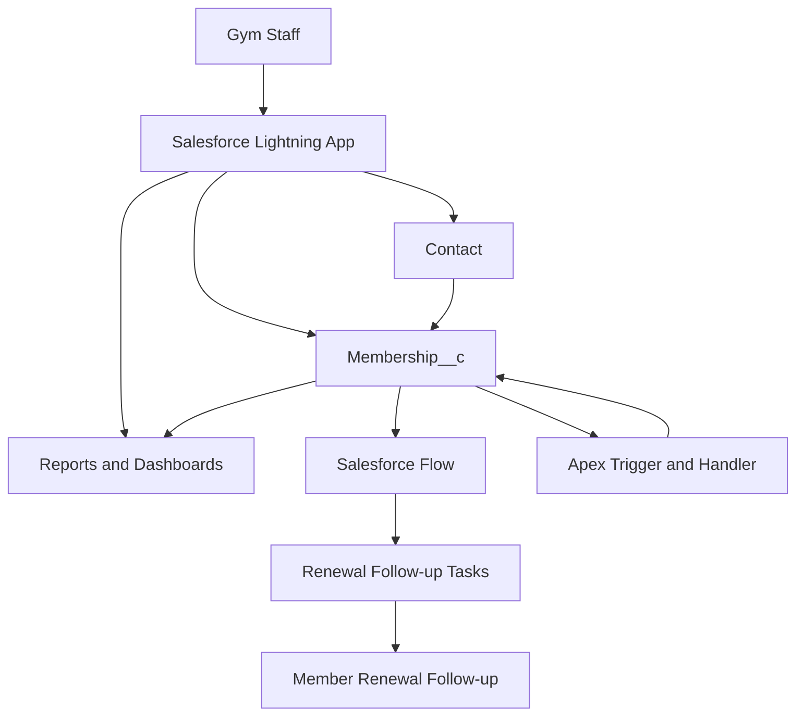

# 🏋️ Rugged Weights
### Salesforce-Powered Gym Membership, Renewal & Retention Management System


**Rugged Weights** is a Salesforce-based gym membership management project designed to organize member information, track membership validity, manage renewals, automate follow-ups, and provide actionable insights into membership retention.

The project demonstrates how Salesforce administration and development capabilities can be combined to build a practical business solution using custom objects, relationships, Salesforce Flow, Apex, Lightning Web Components (LWC), reports, and dashboards.

---

## 📌 Table of Contents

- [Project Overview](#-project-overview)
- [Business Problem](#-business-problem)
- [Project Objectives](#-project-objectives)
- [Features](#-features)
- [Technology Stack](#-technology-stack)
- [System Architecture](#-system-architecture)
- [Data Model](#-data-model)
- [Automation and Business Logic](#-automation-and-business-logic)
- [Reports and Dashboards](#-reports-and-dashboards)
- [Project Structure](#-project-structure)
- [Getting Started](#-getting-started)
- [Testing Strategy](#-testing-strategy)
- [Security](#-security)
- [Future Enhancements](#-future-enhancements)
- [Learning Outcomes](#-learning-outcomes)
- [Author](#-author)

---

## 🎯 Project Overview

Gyms need an efficient way to manage memberships, identify upcoming expirations, follow up with members, and understand renewal performance.

Rugged Weights aims to centralize these activities on Salesforce.

The solution uses Salesforce records to maintain membership information, automation to support timely follow-ups, and reporting tools to help gym staff monitor membership activity.

**Primary goal:** Build a maintainable Salesforce application that helps gym staff manage memberships and make data-driven retention decisions.

## 🚨 Business Problem

Without a centralized membership management system, gym staff may experience:

- Missed membership renewal dates.
- Delayed communication with members.
- Difficulty identifying expired memberships.
- Limited visibility into membership plan distribution.
- Manual tracking of renewal outcomes.
- Difficulty measuring retention and renewal performance.

Rugged Weights addresses these challenges through structured data, automation, and reporting.

## 🎯 Project Objectives

1. Centralize gym member and membership information.
2. Track membership start dates, end dates, and statuses.
3. Identify memberships approaching expiration.
4. Create follow-up tasks for renewal management.
5. Automate appropriate business processes with Salesforce Flow and Apex.
6. Visualize membership and renewal information through reports and dashboards.
7. Apply Salesforce development, security, and testing best practices.

---

## ✨ Features

### 1. Member Management
Maintain member information using Salesforce Contact records.

Potential capabilities:
- Member name and contact details.
- Email address and phone number.
- Related membership records.
- Access to member information according to permissions.

### 2. Membership Management
Use the custom `Membership__c` object to represent gym memberships.

Membership information can include:
- Membership name or identifier.
- Member relationship.
- Membership type or plan.
- Start date.
- End date.
- Membership status.
- Renewal status or outcome.

The exact fields depend on the configuration in the Salesforce org.

### 3. Membership Expiry Tracking
Identify memberships that are:
- Active.
- Expiring soon.
- Expired.
- Renewed.
- Cancelled, where supported by the data model.

This information can support renewal planning and retention activities.

### 4. Renewal Follow-Up Automation
Use Salesforce Flow to identify upcoming expirations and support the creation of follow-up tasks.

Example business scenario:

When a membership is approaching its end date, Salesforce can identify the relevant member and create a task for the responsible user to contact them about renewal.

Automation should be configured to prevent duplicate tasks and handle date boundaries correctly.

### 5. Apex Business Logic
Apex can be used for server-side business logic that is more appropriate for code than declarative automation.

Potential applications include:
- Membership validation.
- Bulk-safe record processing.
- Reusable service and handler classes.
- Unit tests for business rules.
- Integration with Lightning Web Components.

### 6. Lightning Web Components
Lightning Web Components can provide a custom user interface for membership operations.

Planned possibilities include:
- Membership summary cards.
- Upcoming expiry lists.
- Renewal follow-up views.
- Membership statistics.
- Interactive retention dashboards.

### 7. Reports and Dashboards
Salesforce reports and dashboards can help staff understand membership activity.

Proposed reports:
- Membership Status Distribution.
- Membership Count by Membership Type.
- Memberships Expiring Soon.
- Expired Memberships.
- Renewal Outcomes by Month.

Dashboard charts may include donut, bar, and column charts, depending on report configuration and available data.

---

## 🛠️ Technology Stack

| Technology | Purpose |
|---|---|
| Salesforce Lightning Experience | Application platform and user interface |
| Salesforce Custom Objects | Store membership-specific information |
| Salesforce Standard Objects | Reuse Contact and Task capabilities |
| Salesforce Flow | Declarative automation and follow-ups |
| Apex | Server-side business logic |
| Apex Triggers | Respond to record changes when required |
| Lightning Web Components | Custom Lightning user interface |
| Salesforce Reports | Analyze membership and renewal data |
| Salesforce Dashboards | Visualize key metrics |
| Salesforce CLI | Retrieve and deploy metadata |
| Visual Studio Code | Development environment |
| Git | Source control and version history |
| GitHub | Source code hosting and portfolio presentation |
| Jest | Optional LWC unit testing, where configured |

---

## 🏗️ System Architecture



### Architecture overview

- **User interface:** Salesforce Lightning Experience and, where implemented, LWC.
- **Data layer:** Standard Salesforce objects and custom membership objects.
- **Automation layer:** Salesforce Flow and Apex.
- **Analytics layer:** Salesforce reports and dashboards.
- **Development workflow:** Salesforce CLI, VS Code, Git, and GitHub.

The diagram represents the intended architecture. Actual components should be updated as implementation progresses.

---

## 🗂️ Data Model

### Core objects

| Object | API Name | Responsibility |
|---|---|---|
| Contact | `Contact` | Stores gym member contact information |
| Membership | `Membership__c` | Stores membership dates, type, status, and renewal information |
| Task | `Task` | Tracks follow-up activities and renewal reminders |

### Important relationships

**Membership → Contact**

The custom `Member__c` lookup on `Membership__c` can associate a membership with a Contact record.

Example:

```text
Contact
  └── Member: Example Gym Member
        └── Membership__c
              ├── Membership Type
              ├── Start Date
              ├── End Date
              └── Status
```

**Task → Contact and Membership**

A Salesforce Task can be associated with a Contact through its Name relationship (`WhoId`) and with a supported record through its Related To relationship (`WhatId`).

For example, a renewal follow-up Task may reference the member Contact and the related Membership record, provided the relationship is supported and configured correctly.

### Example membership fields

| Field Label | Example API Name | Purpose |
|---|---|---|
| Member | `Member__c` | Lookup to Contact |
| Start Date | `Start_Date__c` | Membership start date |
| End Date | `End_Date__c` | Membership expiration date |
| Membership Status | `Status__c` | Current membership status |
| Membership Type | `Membership_Type__c` | Plan or membership category |
| Renewal Outcome | `Renewal_Outcome__c` | Tracks renewal results, if implemented |

**Note:** Confirm the API names in Object Manager. The names above are examples for fields whose exact configuration may differ in your org.

---

## ⚙️ Automation and Business Logic

### Membership Expiry Monitoring

A scheduled-triggered Flow can evaluate membership records based on their end dates.

Example business rule:

```text
Membership End Date >= Current Date
AND
Membership End Date <= Current Date + 7 days
```

This identifies memberships expiring today through the next seven days, inclusive.

### Renewal Follow-Up

The automation can create a Task containing:
- A subject such as "Contact Member for Membership Renewal".
- A due date.
- The responsible user.
- The member Contact relationship.
- The related Membership record, where supported.

### Automation Best Practices

- Prevent duplicate follow-up tasks.
- Use clear entry criteria.
- Handle blank dates and inactive memberships.
- Test date boundaries.
- Use bulk-safe Apex when processing multiple records.
- Write unit tests for Apex business logic.
- Respect Salesforce security and record access requirements.

---

## 📊 Reports and Dashboards

The following reports are proposed for the project.

### 1. Membership Status Distribution
**Recommended visualization:** Donut chart.

Displays the number of memberships in each status, helping staff understand the current membership portfolio.

### 2. Membership Count by Membership Type
**Recommended visualization:** Bar chart.

Compares membership volumes across available plans or membership categories.

### 3. Renewal Outcomes by Month
**Recommended visualization:** Column chart.

Shows renewal outcomes over time using a suitable renewal date and outcome field.

### Additional reports
- Memberships Expiring in the Next Seven Days.
- Expired Memberships Requiring Follow-Up.
- Memberships by Plan.
- Member Contact and Membership Details.

Use report types that expose the necessary related Contact fields when member contact information is required.

For accurate monthly renewal reporting, record the actual renewal date and outcome rather than relying only on the membership end date.

---

## 📁 Project Structure

Typical Salesforce DX project structure:

```text
Rugged-Weights/
├── .forceignore
├── .gitignore
├── README.md
├── sfdx-project.json
├── package.json
├── config/
├── scripts/
└── force-app/
    └── main/
        └── default/
            ├── classes/
            ├── triggers/
            ├── objects/
            ├── flows/
            ├── lwc/
            ├── layouts/
            ├── tabs/
            ├── permissionsets/
            └── applications/
```

Some directories may not exist until you add the corresponding metadata. Your actual repository structure is the source of truth.

---

## 🚀 Getting Started

### Prerequisites

Install the following:

- A Salesforce Developer Edition org or another authorized development org.
- Salesforce CLI.
- Visual Studio Code.
- Salesforce Extension Pack for VS Code.
- Git.

### 1. Clone the repository

```bash
git clone https://github.com/YOUR-USERNAME/Rugged-Weights.git
cd Rugged-Weights
```

Replace `YOUR-USERNAME` with the actual GitHub account that owns the repository.

### 2. Authorize your Salesforce org

```bash
sf org login web --alias FitOpsDev
```

A browser window will open so you can log in to Salesforce.

### 3. Check the authorized org

```bash
sf org list
```

Confirm that `FitOpsDev` is listed and points to the intended development org.

### 4. Deploy the project metadata

After reviewing the project and confirming that its metadata is compatible with the target org:

```bash
sf project deploy start --source-dir force-app --target-org FitOpsDev
```

Deploying metadata changes the target Salesforce org. Review the deployment before running it against any org containing important data.

### 5. Retrieve metadata changes

To retrieve the Membership custom object:

```bash
sf project retrieve start --metadata "CustomObject:Membership__c" --target-org FitOpsDev
```

Retrieve other metadata types as needed, and review the resulting changes before committing them.

---

## 🧪 Testing Strategy

Testing should cover the following scenarios as the corresponding features are implemented.

### Membership data
- Create a membership linked to a Contact.
- Verify required fields and validation rules.
- Test invalid date combinations.
- Test records with missing optional values.

### Expiry automation
- Membership expiring today.
- Membership expiring in seven days.
- Membership expiring in eight days.
- Already-expired membership.
- Membership without an end date.
- Repeated flow execution without duplicate Tasks.

### Apex
- Positive and negative business scenarios.
- Multiple records processed in one transaction.
- Appropriate assertions in unit tests.
- Error handling and applicable security checks.

### Reporting
- Verify report filters.
- Confirm grouping and record counts.
- Validate chart data against underlying records.
- Check monthly renewal outcomes against actual renewal dates.

---

## 🔐 Security

Security is an important part of a production-quality Salesforce application.

Recommended practices:

- Apply least-privilege access.
- Configure object permissions and field-level security.
- Use permission sets to grant required access.
- Respect record-level sharing.
- Review Apex sharing behavior and data-access enforcement.
- Never commit passwords, session IDs, access tokens, or private keys.
- Exclude local Salesforce authentication directories from Git.
- Use synthetic data in public demonstrations and screenshots.

---

## 🛣️ Future Enhancements

Potential improvements include:

- A custom LWC membership management dashboard.
- Automated email reminders for expiring memberships.
- Renewal history and retention analytics.
- A payment tracking module.
- Trainer and workout plan management.
- Attendance tracking.
- Duplicate prevention and improved error handling.
- More comprehensive Apex and LWC tests.
- A CI/CD pipeline for Salesforce metadata validation and deployment.
- AI-assisted member retention recommendations, if supported by suitable data and requirements.

These are possible future features, not claims that they are already implemented.

---

## 🎓 Learning Outcomes

This project provides practical experience with:

- Salesforce data modeling and relationships.
- Custom objects, fields, and validation rules.
- Salesforce Flow and scheduled automation.
- Apex classes, triggers, and unit testing.
- Lightning Web Components.
- Reports and dashboards.
- Salesforce CLI and metadata management.
- Git version control and GitHub collaboration.
- Salesforce security and development best practices.

---

## 👨‍💻 Author

**Yuvraj Kumar**

Salesforce Development | Apex | Lightning Web Components | Salesforce Flow | Salesforce CLI

GitHub: [yuvraj310104-ops](https://github.com/yuvraj310104-ops)

---

## 📄 License

No license has been selected yet. If you intend to make this repository public for reuse, consider adding an appropriate open-source license after reviewing its terms.

---

⭐ If you find this project useful, consider starring the repository and following its development.
